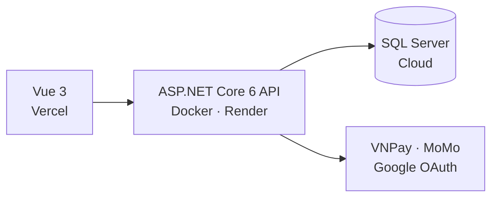

**Xây dựng API · Thiết kế cơ sở dữ liệu · Triển khai hệ thống thực tế**

 

## 👋 Xin chào

Mình là **Thắng**, vừa tốt nghiệp **Lập trình web tại Cao đẳng FPT Polytechnic** (GPA 3.63/4.0). Mình từng thực tập tại **JITS Innovation Labs** và làm **Trưởng nhóm** đồ án tốt nghiệp.

Mình thích những bài toán backend cần dữ liệu chính xác: giữ ghế khi nhiều người cùng đặt, tính lương không bị trùng, cập nhật trạng thái theo thời gian thực. Cả ba dự án dưới đây đều có mã nguồn, hai trong số đó có demo để dùng thử ngay.

 

## 🚀 Dự án

<table>
<tr>
<td width="33%" valign="top">

### 🎬 Cinema Booking
*Đặt vé và quản lý rạp chiếu phim*

Khách đặt vé, nhân viên bán vé tại quầy, quản trị viên theo dõi doanh thu.

[Frontend](https://github.com/hoangthang183204/CinemaBooking-Vue) · [Backend](https://github.com/hoangthang183204/CinemaBooking-API)

</td>
<td width="33%" valign="top">

### ✅ TaskFlow
*Quản lý công việc nhóm*

Phân công việc, theo dõi tiến độ, trạng thái cập nhật theo thời gian thực. Dự án thực tập.

[Frontend](https://github.com/hoangthang183204/taskflow-frontend) · [Backend](https://github.com/hoangthang183204/taskflow-backend)

</td>
<td width="33%" valign="top">

### 👥 HR Flow
*Quản lý nhân sự*

Hồ sơ, hợp đồng, chấm công, nghỉ phép, tính lương, 5 vai trò. Đồ án tốt nghiệp.

[Mã nguồn](https://github.com/hoangthang183204/doantotnghiep)

</td>
</tr>
</table>

 

### Mỗi dự án có gì?

<b>🎬 Cinema Booking</b>: hệ thống đặt vé chạy thật

 

- **Giữ ghế có thời hạn**, tự hủy đơn quá hạn thanh toán và trả lại ghế, bắp nước, lượt mã giảm giá
- **Thanh toán:** VNPay (Return URL và IPN), MoMo (Sandbox), QR chuyển khoản, tại quầy
- **Đăng nhập:** JWT và Google OAuth 2.0, phân quyền Khách hàng, Nhân viên, Quản trị viên
- **Nhân viên:** POS bán vé, quét QR soát vé, tồn kho bắp nước, mở ca và bàn giao ca
- **Quản trị:** dashboard doanh thu và tỷ lệ lấp đầy ghế, quản lý phim, suất chiếu, khuyến mãi, xuất báo cáo Excel
- **Kiến trúc:** Clean Architecture 4 tầng (Domain, Application, Infrastructure, API)
- **Triển khai:** Vercel, Docker trên Render, SQL Server cloud, có CORS, biến môi trường và health check

<b>✅ TaskFlow</b>: quản lý công việc theo thời gian thực

 

- **API:** RESTful bằng Node.js và Sails.js, xác thực JWT và phân quyền
- **Dữ liệu:** MongoDB với Index, Pagination, xử lý truy vấn N+1
- **Hiệu năng:** Redis Cache và Rate Limiting
- **Thời gian thực:** WebSocket cập nhật trạng thái công việc
- **Giao diện:** Next.js, Optimistic UI để phản hồi nhanh
- **Triển khai:** Docker, CI/CD

<b>👥 HR Flow</b>: nhân sự, chấm công và tính lương

 

- **Chấm công bằng nhận diện khuôn mặt** chạy nền, chỉ lưu đặc trưng khuôn mặt, không lưu ảnh gốc
- **Tính lương an toàn:** khóa kỳ lương theo tháng, khóa dòng đơn nghỉ khi duyệt, tránh tạo trùng bảng lương hoặc trừ phép hai lần
- **Bảo mật:** mã hóa CCCD, mã số thuế, số BHXH, tài khoản ngân hàng; ghi nhật ký giá trị cũ và mới khi sửa lương, giờ công
- **Phân quyền 5 vai trò:** Super Admin, HR, Kế toán, Trưởng phòng, Nhân viên
- **Vai trò của mình:** Trưởng nhóm, chia việc và theo dõi tiến độ, tham gia thiết kế cơ sở dữ liệu MySQL

 

## 🛠️ Công nghệ

 

## 📚 Đang học thêm

| Lĩnh vực | Nội dung |
|---|---|
| **Cấu trúc dữ liệu và giải thuật** | Hash Map, Linked List, Tree, Graph, Dynamic Programming |
| **System Design** | Scalability, Load Balancing, Caching, API Gateway |
| **Database** | Indexing, Transactions, Query Optimization |
| **DevOps** | Docker, CI/CD, Nginx |

 

### 📫 Liên hệ

**thanghoang182004@gmail.com** · Hà Nội, Việt Nam

